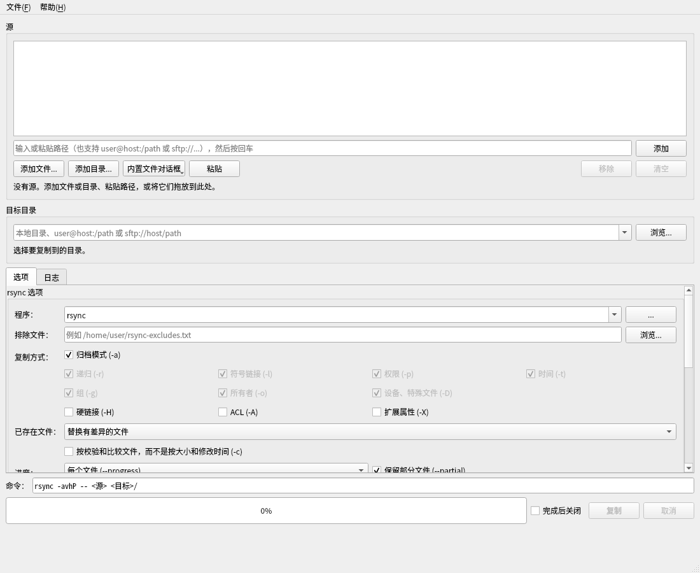

# Rsync GUI 中文版

基于 Qt 6 的 `rsync` 图形前端，用于复制、移动文件，并在复制后按校验和验证结果。
本仓库是 **简体中文版**：程序界面、菜单、按钮、提示、日志和 Dolphin 右键菜单均已翻译。

> 原项目：<https://github.com/fapped/rsync-gui>


> 本中文版在源码中加入了 `translations/rsync-gui_zh_CN.ts` 和编译好的
> `translations/rsync-gui_zh_CN.qm`，并在启动时自动加载。

## 已安装版本

当前机器已经编译并安装到用户目录：

```bash
~/.local/bin/rsync-gui
```

启动方式：

```bash
rsync-gui
# 或
~/.local/bin/rsync-gui
```

也可以从应用菜单中找到 **Rsync GUI 中文版**；Dolphin 中会多出 **Rsync** 右键子菜单。

## 功能

- 源文件/目录列表：按钮添加、粘贴路径、拖放、命令行传入
- 支持本地路径、`user@host:/path`、`sftp://host/path`
- 目标目录：本地目录（自动创建）或远程目录，带最近使用列表
- 常用 rsync 选项：
  `-a` 及其分项（`-r -l -p -t -g -o -D`）、`-H`、`-A`、`-X`、`-v`、`-h`、
  `--partial`、`--progress` / `--info=progress2`、`-c`、`-u`、
  `--ignore-existing`、`-z`、`--bwlimit`、`-e`、`--delete`、
  `--remove-source-files`、`-n`、复制目录内容、**排除文件选择框**（`--exclude-from`）、附加参数
- 复制后校验：第二次 rsync 以 `--checksum` 比较源和目标，列出不同或缺失的文件
- 命令预览、进度条、实时速度曲线、速度和剩余时间、带时间戳的日志
- 取消任务；只在会删除文件的选项上二次确认
- 传输完成后可自动关闭窗口
- KDE Plasma 任务管理器/通知区域中的外部进度（含速度、剩余时间、取消和“打开目标”）
- 选项记忆、JSON 导入/导出、预设、Dolphin 右键菜单

## 构建（Debian / Ubuntu）

依赖：

```bash
sudo apt install build-essential cmake ninja-build qt6-base-dev \
                 qt6-translations-l10n rsync
```

构建：

```bash
cmake -S . -B build -G Ninja -DCMAKE_BUILD_TYPE=Release
cmake --build build
```

运行：

```bash
./build/rsync-gui
./build/rsync-gui ~/照片 ~/文档/报告.pdf --destination /media/backup
./build/rsync-gui --preset rsync-copy-verify --browse-destination ~/照片
```

安装到当前用户（无需 root）：

```bash
cmake --install build --prefix ~/.local
```

安装到系统：

```bash
sudo cmake --install build
```

## 排除文件

“排除文件”一栏可以直接选择每行一个 rsync 排除模式的文件，程序会生成
`--exclude-from=/路径`，并在校验时同样使用。路径是本地路径，文件内容示例：

```text
**/build_dir/
**/node_modules/
*.tmp
```

本机可使用：

```text
/home/urey/sysbackup/rsync-gui-excludes.txt
```

该路径会随选项一起记住；也可以写进 JSON 设置/预设的 `excludeFile` 字段：

```json
{
  "format": "rsync-gui-settings",
  "version": 1,
  "name": "系统备份",
  "options": {
    "excludeFile": "/home/urey/sysbackup/rsync-gui-excludes.txt",
    "archive": true,
    "hardLinks": true,
    "acls": true,
    "xattrs": true
  }
}
```

## 预设

| 菜单名称 | `--preset` | 效果 |
|---|---|---|
| 复制 (-a) | `rsync-copy` | 归档模式、显示文件列表、进度、保留部分文件 |
| 复制并校验 (-ac) | `rsync-copy-verify` | 上述功能 + 校验和比较 + 二次校验 |
| 复制到 FAT/NTFS/NAS (-rlt) | `rsync-copy-portable` | 只保留递归、符号链接和时间，适合 FAT/exFAT/NTFS/NAS |
| 移动 (-a) | `rsync-move` | 复制后删除源文件，并删除变空的源目录（会二次确认） |
| 移动并校验 (-ac) | `rsync-move-verify` | 校验通过后才删除源文件 |
| 移动到 FAT/NTFS/NAS (-rlt) | `rsync-move-portable` | 同上，适合无 Unix 权限/所有者的目标 |

```bash
rsync-gui --list-presets
rsync-gui --preset rsync-copy-verify --browse-destination ~/照片
```

## 注意

- **移动**（`--remove-source-files`）会删除源文件，第一次使用建议先勾选“演练”(-n)。
- **`--delete`** 会让目标成为源的精确镜像，目标中多出的文件会被删除。
- **FAT/exFAT** 请使用 `-rlt` 预设；程序会自动检测并添加 `--modify-window=1`。
- 远程复制需要 `ssh` 和远端 `rsync`；`sftp://` URL 的端口会自动传给 ssh。
- 本项目是 AI 生成代码的上游项目的中文分支，使用前请自行审查，尤其是移动文件功能。

## 翻译维护

源字符串使用 Qt 的 `tr()`。翻译文件：

```
translations/rsync-gui_zh_CN.ts    # 可编辑的翻译源文件
translations/rsync-gui_zh_CN.qm    # 编译后的翻译，嵌入程序
```

修改 `.ts` 后重新生成 `.qm`：

```bash
lrelease translations/rsync-gui_zh_CN.ts -qm translations/rsync-gui_zh_CN.qm
cmake --build build
```

如果 Qt 标准对话框（文件选择、消息框按钮等）也要完整中文，请安装
`qt6-translations-l10n`；程序会自动从 Qt 的翻译目录加载 `qt_zh_CN.qm`。
