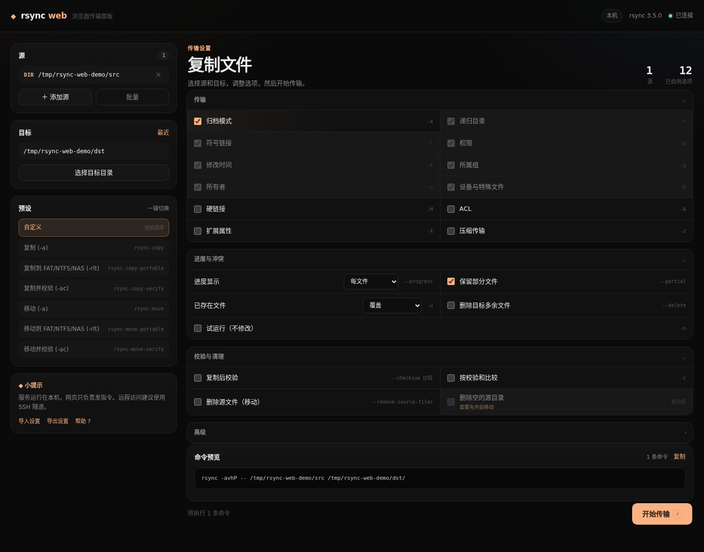
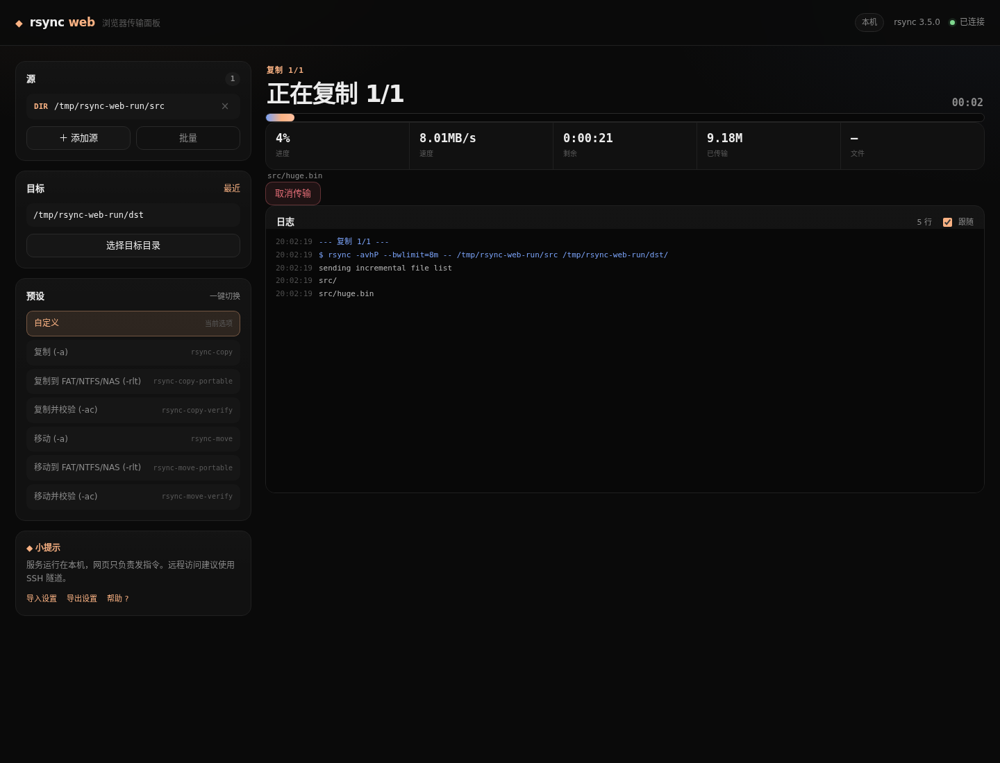

# rsync-web

> 在浏览器里使用 rsync：本地启动一个服务，远端打开网页操作。
> 单文件 Go 服务 + 内嵌前端，不需要 Node.js、Qt 或桌面环境。

`rsync-web` 把 Qt 图形界面的核心工作流搬到网页：源列表、目标目录、预设、常用 rsync
选项、命令预览、实时进度/速度/ETA、日志、取消、会删除文件时的二次确认，以及本机
文件浏览器。后端直接调用本机 `rsync`，前端通过 SSE 接收进度，不需要轮询。





## 功能

- 源：本地路径、`user@host:/path`、`sftp://user@host:port/path`
- 批量粘贴多个源；本机路径可以在网页里浏览选择
- 目标：本地目录或 SSH 远程目录；自动创建本地目标；最近目标
- 预设：复制、复制并校验、FAT/NAS 兼容、移动、移动并校验
- 选项：`-a` 及分项、`-H -A -X -z`、进度模式、`--partial`、`-c`、`-u`、
  `--delete`、`--remove-source-files`、`--bwlimit`、SSH 密钥、排除文件、
  `--link-dest`、Git 跟踪文件、试运行等
- 命令预览；复制/校验/删除源文件多个阶段会分别显示
- 实时进度、速度、ETA、文件计数、日志、取消
- 会删除文件的操作必须二次确认
- 设置 JSON 导入/导出，与 rsync-gui 格式兼容
- 深色响应式界面，手机浏览器也能操作

## 构建与运行

运行时只需要 `rsync`，远程传输额外需要 `ssh`。构建需要 Go 1.24.2+。

```bash
cd web
make                 # 生成 web/bin/rsync-web
./bin/rsync-web      # http://127.0.0.1:8787
```

安装到系统：

```bash
sudo make install PREFIX=/usr/local
rsync-web
```

常用参数：

```bash
rsync-web --listen 127.0.0.1:8787
rsync-web --listen 0.0.0.0:8787          # 自动生成访问令牌
rsync-web --listen 0.0.0.0:8787 --token my-secret
rsync-web --version
```

## 远端访问

最推荐 SSH 隧道，不把服务直接暴露到局域网：

```bash
# 在远端主机
rsync-web --listen 127.0.0.1:8787

# 在本地电脑
ssh -L 8787:127.0.0.1:8787 user@remote-host
# 然后打开 http://127.0.0.1:8787
```

如果确实需要局域网直接访问：

```bash
rsync-web --listen 0.0.0.0:8787
```

启动时会打印本机、局域网和访问令牌。打开带 `?token=...` 的链接即可；令牌也会保存在
HttpOnly Cookie 中。也可以给 API 使用：

```bash
curl -H "Authorization: Bearer <token>" http://host:8787/api/bootstrap
```

> 服务本身不带 TLS。公网访问请使用 SSH 隧道、VPN 或 HTTPS 反向代理；不要在不可信网络
> 上明文暴露带令牌的服务。

## 界面操作

- 左栏添加源、选择目标、点击预设
- 中间调整选项；页面底部实时显示完整 rsync 命令
- `r` 开始，`Esc` 关闭弹窗，`?` 打开帮助
- 运行页显示进度、速度、剩余时间、当前文件和日志
- `--delete` / `--remove-source-files` 会在开始前显示确认弹窗

网页里的“浏览本机”读取的是**运行服务的主机**文件系统，不是浏览器所在电脑。
远程路径（`user@host:/path`）不能浏览，直接输入即可。

## 安全模型

- 默认只监听 `127.0.0.1`，此时不要求令牌
- 监听非本机地址且没有 `--token` 时，启动时生成随机令牌
- 令牌支持 `?token=` 登录、HttpOnly Cookie、`Authorization: Bearer`
- 页面启用了 CSP、`X-Frame-Options: DENY`、`nosniff` 等安全头
- 服务不处理 SSH 密码/未知主机密钥；请提前配置密钥或 `ssh-agent`

## 架构

```text
web/
  cmd/rsync-web/        CLI 入口、监听地址、令牌、优雅退出
  internal/server/      HTTP 路由、认证、SSE、任务管理、文件浏览
  internal/server/assets/  内嵌的 HTML/CSS/JS
  internal/config/      选项、预设、设置 JSON（与 rsync-gui 兼容）
  internal/location/    本地/远程路径解析
  internal/rsync/       命令构建、执行、进度、校验、清理
  presets/              内嵌预设
```

后端同一时间只运行一个 rsync 任务，事件通过 `/api/events` 的 SSE 流推送；页面刷新
后会收到包含当前状态和历史日志的 `snapshot`。会修改文件的选项不会从上次会话自动恢复
（`--delete`、`--remove-source-files`、`-n` 等只在当前会话/预设中生效），这一点与
rsync-gui/TUI 的安全设计一致。

## API

| 方法 | 路径 | 说明 |
| --- | --- | --- |
| `GET` | `/api/bootstrap` | 选项、源/目标、预设、当前任务快照 |
| `POST` | `/api/plan` | 校验并预览命令，不创建目标 |
| `POST` | `/api/start` | 开始任务；破坏性操作需要 `confirm: true` |
| `GET` | `/api/events` | SSE：`snapshot` / `state` / `log` / `done` |
| `POST` | `/api/cancel` | 取消当前任务 |
| `GET` | `/api/browse?path=` | 浏览本机目录 |
| `POST` | `/api/settings/export` | 导出 rsync-gui 兼容设置 |
| `POST` | `/api/settings/import` | 导入设置文件 |
| `GET` | `/healthz` | 健康检查 |

## 开发

```bash
cd web
make test
make vet
make build
```

测试包括认证、计划/确认、文件浏览、设置导入导出，以及一次真实的 rsync 复制任务。

## 已知限制

- 同一时间只运行一个传输
- 不处理 SSH 密码和未知主机密钥交互；请用密钥/`ssh-agent`
- 不支持远程到远程复制和 rsync daemon
- 网页文件浏览器只支持本机路径
- 没有用户系统；安全边界是监听地址 + 访问令牌

## 许可

与原项目一致，MIT。见仓库根目录 [LICENSE](../LICENSE)。
